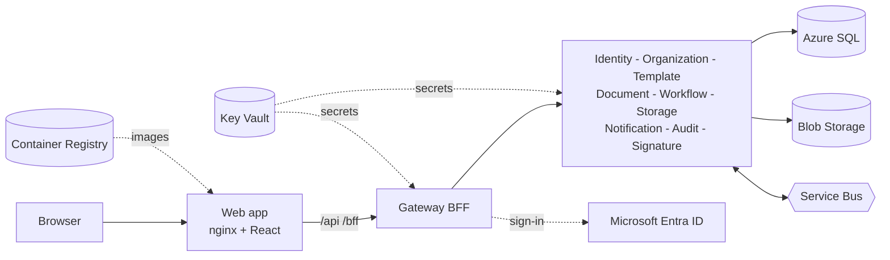

# 02 - Deploy to Azure (Dev and Prod)

This guide takes you from an empty Azure subscription to a running **Dev** and **Prod** environment using the Bicep template in `infra/` and the Azure DevOps pipelines in `pipelines/`. Dev and Prod use the same code; only the parameter file, variable file and variable group differ.



Each environment = one resource group containing: App Service plan (Linux) with **11 container apps** (Gateway, 9 services, web), Azure SQL (`EdpDb`, `EdpSigningDb`), Storage account (containers `templates`, `documents`, `signed-documents`), Service Bus (topics/subscriptions), Key Vault, Container Registry, Log Analytics and Application Insights. Apps pull images and read secrets with **managed identity**; no registry passwords or plaintext connection strings in app settings.

## 1. What you need

- An Azure subscription where you can create resources and role assignments (Owner, or Contributor + User Access Administrator, on the resource group/subscription).
- Azure DevOps project with this repo, **or** a workstation with Azure CLI + Docker for a manual deployment (section 8).
- Rights to create an app registration in Microsoft Entra ID (or ask your Entra admin).
- Provider registration (once per subscription): `Microsoft.Web`, `Microsoft.Sql`, `Microsoft.ServiceBus`, `Microsoft.KeyVault`, `Microsoft.ContainerRegistry`, `Microsoft.Storage`, `Microsoft.Insights`, `Microsoft.OperationalInsights`.

## 2. Configuration reference - what differs per environment

| Setting | Where | Dev | Prod |
|---|---|---|---|
| Resource group, region, service connection | `pipelines/variables/<env>.yml` | `rg-edp-dev`, `eastus`, `sc-edp-dev` | `rg-edp-prod`, `eastus2`, `sc-edp-prod` |
| App Service plan SKU / instances | `infra/<env>.bicepparam` | B3 x 1 | P1v3 x 2, zone-redundant, autoscale 2-4 |
| SQL database SKU / backup redundancy | same | S0 / Local | S2 / Geo |
| Storage SKU | same | Standard_LRS | Standard_GZRS |
| ACR SKU | same | Basic | Standard |
| Key Vault purge protection, log retention | same | off, 30 d | on, 90 d |
| Gateway rate limit | same | 100 / min | 300 / min |
| Secrets & Entra IDs | Azure DevOps variable group `edp-<env>` | own app registration | own app registration |
| Approval gate | Azure DevOps Environment `edp-<env>` | none | required approvers |

All parameters (including the Service Bus topics, blob containers, firewall ranges, `webPublicUrl` for a custom domain, `aspNetCoreEnvironment`) are documented in `infra/main.bicep`. Add another environment (e.g. `test`) by copying `infra/dev.bicepparam` and `pipelines/variables/dev.yml` and adding a stage in `pipelines/cd.yml`.

> The apps run with `ASPNETCORE_ENVIRONMENT=Production` on Azure. Demo sign-in therefore does not exist there; users sign in with Entra ID.

## 3. Entra ID app registration (once per environment)

You can reuse one registration for Dev and Prod, but separate registrations are cleaner.

1. Entra admin center -> **App registrations -> New registration**. Name `EDP Dev`, single tenant, no redirect URI yet.
2. **Authentication -> Add a platform -> Web**. Add redirect URI `https://<web-host>/signin-oidc` and front-channel logout URL `https://<web-host>/signout-callback-oidc`. `<web-host>` is printed by the first infrastructure deployment (output `entraRedirectUri`); the pattern is `edp-<env>-web-<6 chars>.azurewebsites.net`. If you use a custom domain, use that.
3. **Certificates & secrets -> New client secret.** Copy the value now (you cannot read it later).
4. **Expose an API -> Set Application ID URI** (accept `api://<client-id>`) **-> Add a scope** named `access_as_user` (admins and users can consent).
5. **Manifest** -> set `"requestedAccessTokenVersion": 2` (under `api`) so access tokens are v2 (`aud` = the client id, issuer `https://login.microsoftonline.com/<tenant>/v2.0`, which is what the services validate).
6. **App roles** -> create roles matching the platform permissions and assign users/groups under *Enterprise applications -> Users and groups*: `OrganizationAdmin`, `SigningManager`, `Signer`, `Auditor`, `Workflow.Read`, `Workflow.Create`, `Workflow.Update`, `Workflow.Validate`, `Workflow.Publish`, `Workflow.Start`, `Workflow.Cancel`, `Workflow.Suspend`, `Workflow.Resume`, `Approval.Read`, `Approval.Approve`, `Approval.Reject`, `Approval.Delegate`. (Allowed member types: Users/Groups.)
7. Note **Tenant ID** and **Application (client) ID**.

If the redirect URI is not known yet, deploy first without Entra values (section 5/6), read the `entraRedirectUri` output, then complete steps 2-7 and re-run the deployment with the Entra variables set.

## 4. Azure DevOps setup

1. **Service connections** (Project settings -> Service connections -> New -> Azure Resource Manager -> Workload identity federation recommended). Create `sc-edp-dev` and `sc-edp-prod` (names must match `pipelines/variables/*.yml`). Scope them to the subscription; the identity needs **Contributor** and **User Access Administrator** (the Bicep creates role assignments for the apps' managed identities).
2. **Variable groups** (Pipelines -> Library): create `edp-dev` and `edp-prod`:

   | Variable | Secret | Value |
   |---|---|---|
   | `SQL_ADMIN_PASSWORD` | yes | 16+ chars, mixed case, digits and symbols |
   | `ENTRA_TENANT_ID` | no | from step 3 (empty on first deploy is allowed) |
   | `ENTRA_CLIENT_ID` | no | from step 3 |
   | `ENTRA_CLIENT_SECRET` | yes | from step 3 |
   | `WEB_PUBLIC_URL` | no | custom domain URL, or a single space/empty for the default host |

   Link secrets to Key Vault if your organisation requires it (Library -> *Link secrets from an Azure key vault*).
3. **Environments** (Pipelines -> Environments): create `edp-dev` and `edp-prod`. On `edp-prod` add **Approvals and checks -> Approvals** with your release approvers.
4. **Pipelines -> New pipeline** -> existing YAML: create two pipelines from `pipelines/ci.yml` (name *EDP CI*) and `pipelines/cd.yml` (name *EDP CD*).
5. Branch policy (recommended): require the *EDP CI* build on PRs into `main`/`develop`.

## 5. First deployment (automated)

1. Push to `develop` (or run *EDP CD* manually). Stages: **Build and test -> Deploy dev**.
2. Deploy dev runs three jobs:
   - **Infrastructure** - creates the resource group, runs a what-if, deploys `infra/main.bicep` with `infra/dev.bicepparam`.
   - **Images** - builds and pushes 11 images (`edp-gateway`, `edp-identity`, ..., `edp-web`) to the environment's registry, tagged with the build id and `latest`.
   - **Release** - applies EF migrations to `EdpDb` (temporarily opening the SQL firewall for the agent), points every app at the new tag, restarts, waits for `/health/live` and runs `scripts/Smoke-Test.ps1`.
3. The first run takes 20-30 minutes (image builds, SQL/Service Bus provisioning). The web URL is printed at the end of *Release* and in the Bicep output `webUrl`.
4. Finish the Entra registration (section 3) if you deferred it, put the IDs/secret in the variable group, and re-run the pipeline.
5. Sign in. A new tenant starts empty: **create an organization** on the first screen (you become its Owner), then follow the demo script. Assign Entra app roles to give users permissions.

## 6. Promote to Prod

1. Merge `develop` into `main`. The CD pipeline builds, deploys Dev, then **waits for approval** on `edp-prod`.
2. Approve. Prod runs the same three jobs against `rg-edp-prod` using `infra/prod.bicepparam` (images are rebuilt from the same commit so the web bundle carries the prod environment label).
3. Check *Release* logs and the smoke test. Done.

Skip an environment or deploy manually: *Run pipeline* -> untick **Deploy DEV/PROD**.

## 7. Rollback

*Run pipeline* -> set **rollbackTag** to a previous build id (visible as the image tag in ACR, or the build number of an earlier run). The image build is skipped; infrastructure is re-applied (idempotent) and the apps are re-pointed to that tag. Database migrations are forward-only: restore from SQL point-in-time restore if a migration must be reverted.

## 8. Manual deployment (no pipeline)

```powershell
az login
az account set --subscription <id>
az group create -n rg-edp-dev -l eastus

$env:SQL_ADMIN_PASSWORD = '<strong password>'
$env:ENTRA_TENANT_ID = '<tenant>'; $env:ENTRA_CLIENT_ID = '<client id>'; $env:ENTRA_CLIENT_SECRET = '<secret>'
az deployment group create -g rg-edp-dev --parameters infra/dev.bicepparam --query "properties.outputs"

# images (bash/WSL/Git Bash, Docker running) - run for each key: gateway identity organization template document workflow storage notification audit digital-signature web
scripts/deploy/build-push.sh rg-edp-dev gateway 1 dev Gateway/Edp.Gateway/Edp.Gateway.csproj Edp.Gateway
scripts/deploy/build-push.sh rg-edp-dev web 1 dev

# migrations (needs your IP allowed on the SQL server firewall)
.\scripts\database\Apply-EdpMigrations.ps1 -ConnectionString "Server=tcp:<sql-fqdn>,1433;Initial Catalog=EdpDb;User ID=edpsqladmin;Password=...;Encrypt=True"

scripts/deploy/release.sh rg-edp-dev 1
```

The service project paths for `build-push.sh` are listed in `pipelines/templates/deploy-environment.yml`.

## 9. Verify the deployment

- `https://<web-host>/healthz` returns `ok`; `https://<gateway-host>/health/live` returns `Healthy`.
- `pwsh scripts/Smoke-Test.ps1 -BaseUrl https://<web-host>` (anonymous checks only on Azure).
- Portal -> resource group -> each app -> *Log stream*, or Log Analytics (`AppServiceConsoleLogs`) for errors.
- Key Vault references show a green tick under App -> *Environment variables*. A red cross means the app's identity cannot read the vault yet (role assignments take a few minutes) - restart the app.

## 10. Operations notes

- **Cost (rough, pay-as-you-go)**: Dev is dominated by the B3 plan (about 100-150 USD/month) plus SQL S0 x 2 and Service Bus Standard; stop the plan's apps or delete the resource group when idle. Prod costs several times more (P1v3 x 2, S2 x 2, GZRS). Use the Azure Pricing Calculator for your region.
- **Rotating secrets**: update the Key Vault secret (or the variable group value and re-run); restart the apps. Rotate the SQL admin password by changing the variable and redeploying.
- **Scaling**: change `appServiceSku` / `appServiceInstanceCount` / autoscale in the parameter file and redeploy.
- **Delete an environment**: `az group delete -n rg-edp-dev`. Key Vault enters soft-delete (30 days); with purge protection (prod) the name stays reserved.

## 11. Hardening checklist before real production use

These are deliberately not enabled by default because they change the network and identity model:

- Private endpoints / VNet integration for SQL, Storage, Service Bus, Key Vault and the service apps; today the downstream services are reachable on the internet but only accept valid Entra tokens.
- Replace SQL authentication with Microsoft Entra authentication for the apps; replace storage/Service Bus keys with managed identity (needs a code change - the services currently use connection strings).
- Put Azure Front Door/WAF and a custom domain in front of the web app (`webPublicUrl`).
- Ensure **every** service has `Jwt__Authority`, `Jwt__Issuer`, `Jwt__Audience` set (the template does this). A service without them would accept unsigned tokens.
- Alerts (App Insights availability tests, 5xx rate, SQL DTU) and a backup/restore drill.
- Rotate any secret that was ever committed or pasted into chat/tickets. In particular, the untracked file `src/Gateway/Edp.Gateway/appsettings.Development.json` on the original developer machine contains a real Entra client secret: rotate it and use `dotnet user-secrets` locally.
